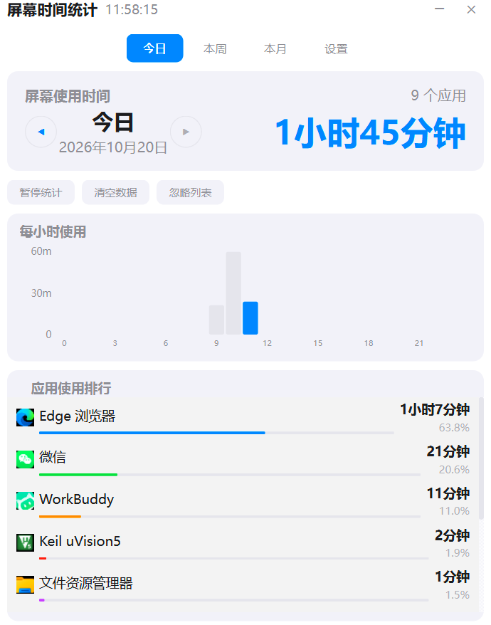
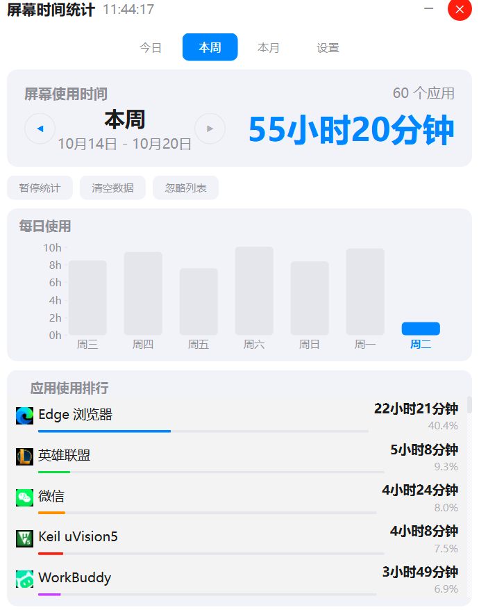
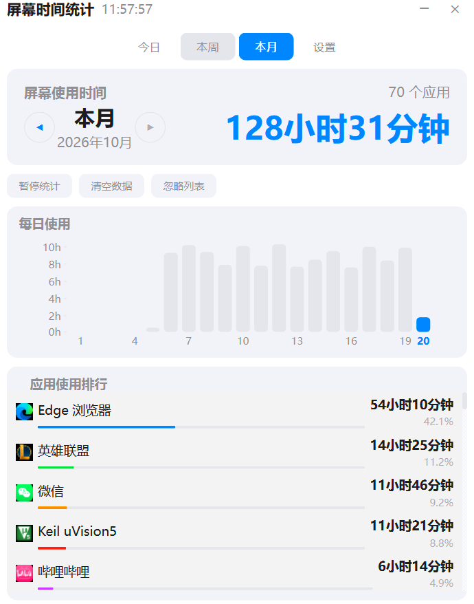

# UsageTime

Windows 桌面屏幕使用时间统计工具，帮助你了解每天在各个应用上花费的时间。

> 本项目基于 [DABIAN-afk/usagetime](https://github.com/DABIAN-afk/usagetime)（MIT License）修改，
> 新增「本月」视图，并修复了锁屏 / 待机期间的时长虚增问题。


## 界面预览

**今日** — 24 小时分布，按小时看使用节奏



**本周** — 7 天趋势



**本月** — 本月每天的使用分布与应用排行（本仓库新增）



## 本仓库相对上游的主要改动

### 1. 修复锁屏 / 待机期间的时长虚增（核心修复）

**问题**：锁屏后输入桌面切换到 Winlogon 桌面，普通进程调 `GetForegroundWindow()`
拿到的是 Default 桌面上的**冻结值**，进程名不再变化；同时从待机恢复（resume）会重置
空闲计时，`idle_threshold = 300` 也拦不住。两者叠加，每锁屏一次就会给「锁屏前最后一个
应用」多记约 8 分钟。

实测某天：非空闲时长合计 563 分钟，其中 **34 分钟落在锁屏区间内（约 6%）**，
`searchhost.exe` 甚至被记成单日 25 分钟——它根本不是被实际使用的程序。

**修复**：新增 `_is_locked()`，用 `OpenInputDesktop` + `GetUserObjectInformationW(UOI_NAME)`
判断输入桌面是否为 `Default`；锁屏和 UAC 安全桌面期间，先结算当前片段、清空窗口状态再停表。
解锁后自动重新识别窗口、开启新片段；由于 `_last_start` 已被清空，待机唤醒也不会把睡眠时长补记进去。

### 2. 新增「本月」视图

- 本月每天的柱状图，31 天自动收窄柱宽、抽稀日期标签，不会挤成一团
- 本月应用排行（跨天合并同一应用）
- 支持翻看上 / 下月，且不会翻到未来的月份

### 3. 界面性能优化

| 优化 | 做法 | 效果 |
|---|---|---|
| 数据库连接复用 | 原来每次查询都新开连接并执行一次 `PRAGMA journal_mode=WAL`（Windows 上单次约 47ms），界面刷新一次要开几百次连接；改为**按线程复用连接** | 切换页面快 **6~7 倍** |
| 排行榜行控件池化 | 不再每次刷新销毁重建控件，改为建好后只更新文本 / 图标 | 57 行省掉约 230ms 的重建开销 |
| 显示名负缓存 | 查不到的名字也缓存，避免每次刷新都重新枚举全系统进程 | 从「一次刷新最多扫描 23 遍」降到 0 次 |
| 图标缓存 | 以 `app_name + exe_path` 为键，未变化则不重新提取 | 刷新时不再重复解图标 |

### 4. 细节修正

- 进度条按控件**实际宽度**计算，修掉「占比 43% 画成 72%、60% 以上直接顶满」的偏差
- 柱状图柱宽、日期标签随天数自适应（本月 31 天也能看）
- 小时刻度按量程自动切换 1h / 2h / 4h 步长
- `_IGNORED` 补充 Win11 的 `searchhost.exe`（上游只列了 Win10 的 `searchui.exe` / `searchapp.exe`）

## 功能特性

- **实时监控** — 每秒检测前台窗口，精确记录应用使用时长
- **锁屏不计时** — 锁屏、待机、UAC 安全桌面期间自动停止计时（本仓库修复）
- **智能休眠** — 无操作超过设定时间自动暂停计时，避免空挂误计
- **今日 / 本周 / 本月统计** — 三档视图，柱状图直观呈现使用分布
- **应用排行** — 按使用时长排序，支持自定义应用名称映射
- **多进程合并** — 同一软件的主进程与辅助进程合并统计，避免重复显示
- **准确图标** — 优先从实际使用的程序文件提取图标，兼容桌面 / 开始菜单快捷方式
- **防止重复计时** — 只允许一个实例运行，误点多次不会重复记录
- **系统托盘** — 最小化到托盘后台运行，左键打开面板
- **暂停 / 恢复** — 临时停止统计，自由控制
- **忽略列表** — 排除不需要统计的应用
- **开机自启** — 一键设置开机自动启动
- **隐私保护** — 数据仅存本地 SQLite，不联网、不上传、不采集任何个人信息

## 安装

### 方式一：下载即用

前往 [Releases](https://github.com/3332864627/usagetime/releases) 下载最新压缩包，
解压后运行 `UsageTracker.exe`，无需 Python 环境。

### 方式二：从源码运行

```bash
git clone https://github.com/3332864627/usagetime.git
cd usagetime
pip install -r requirements.txt
python main.py
```

### 方式三：自行打包

```bash
pip install -r requirements.txt
pip install pyinstaller

python generate_icon.py
pyinstaller app.spec --clean
```

打包产物位于 `dist/UsageTracker/`。

## 测试

```bash
python -m unittest discover -v
python -m compileall -q .
```

## 技术栈

- **UI 框架**：PySide6 (Qt for Python)
- **数据库**：SQLite（WAL 模式，连接按线程复用）
- **进程监控**：psutil + Win32 API（`GetForegroundWindow`）
- **空闲检测**：Win32 API（`GetLastInputInfo`）
- **锁屏检测**：Win32 API（`OpenInputDesktop` + `GetUserObjectInformation`）
- **图标提取**：Win32 IImageList + `SHGetFileInfo`
- **打包**：PyInstaller

## 隐私声明

- 所有数据仅存储在本地 SQLite 数据库中
- 不收集任何个人信息
- 不进行任何网络请求
- 不记录键盘输入内容
- 不截取屏幕
- 不上传任何数据

## 致谢

原项目：[DABIAN-afk/usagetime](https://github.com/DABIAN-afk/usagetime)

## License

MIT
